<div align="center">


# Employee Management MVC

### A practical ASP.NET Core MVC workshop — from Visual Studio setup to a working CRUD application

**Design, build, and run an employee directory with ASP.NET Core MVC, Entity Framework Core, and SQL Server.**

[](https://dotnet.microsoft.com/)
[](https://learn.microsoft.com/ef/core/)
[](https://www.microsoft.com/sql-server)
[](https://visualstudio.microsoft.com/)
[](https://github.com/Lagmouchyoussef/-employee-management-mvc)

**Workshop language:** English&nbsp;&nbsp;·&nbsp;&nbsp;**Audience:** Beginners&nbsp;&nbsp;·&nbsp;&nbsp;**Estimated time:** 60–90 minutes

</div>

> **Project outcome** — A responsive employee directory with complete **Create, Read, Update, and Delete (CRUD)** workflows, server-side validation, and SQL Server persistence.
>
> **Illustration note** — The annotated Visual Studio screens and final UI preview in this guide are original illustrations, not screenshots captured from a running copy of your application. Red frames and numbered markers identify the actions to take; your Visual Studio layout may vary slightly by version.

---

## Contents

- [Final Result Preview](#final-result-preview)
- [Quick Start](#quick-start)
- [Learning objectives](#-learning-objectives)
- [🧰 Prerequisites](#-prerequisites)
- [🏗️ How MVC works](#️-how-mvc-works)
- [🚀 Part 1 — Create the project](#-part-1--create-the-project)
- [📦 Part 2 — Install Entity Framework Core](#-part-2--install-entity-framework-core)
- [🧱 Part 3 — Create the Employee model](#-part-3--create-the-employee-model)
- [🗄️ Part 4 — Create the database context](#️-part-4--create-the-database-context)
- [🔌 Part 5 — Configure SQL Server](#-part-5--configure-sql-server)
- [🧭 Part 6 — Register MVC and Entity Framework](#-part-6--register-mvc-and-entity-framework)
- [⚙️ Part 7 — Generate the CRUD controller and views](#️-part-7--generate-the-crud-controller-and-views)
- [🧬 Part 8 — Create the database with migrations](#-part-8--create-the-database-with-migrations)
- [🎨 Part 9 — Add Employees to the navigation bar](#-part-9--add-employees-to-the-navigation-bar)
- [▶️ Part 10 — Run and test the application](#️-part-10--run-and-test-the-application)
- [🗂️ Expected project structure](#️-expected-project-structure)
- [🧯 Troubleshooting](#-troubleshooting)
- [✅ Final checklist](#-final-checklist)
- [🔗 References](#-references)

---

## Final Result Preview

After the application starts, open **Employees** in the navigation bar. The employee directory displays the saved records and provides the actions needed to manage them.

<div align="center">

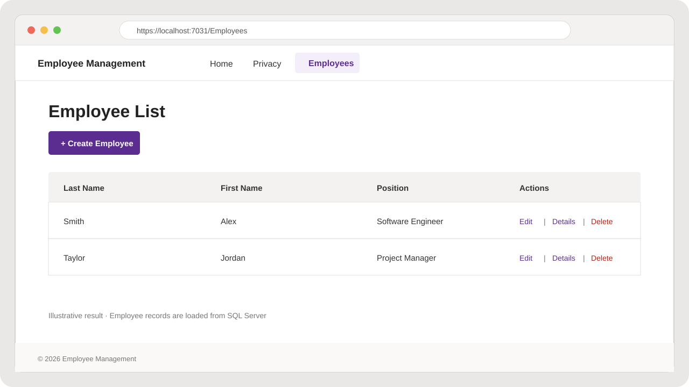

**Expected screen:** employee list with a create button, employee details, and row-level CRUD actions.

</div>

The preview uses example data to make the finished page easy to recognize. It is an illustration; your database starts with the records created by your own tests.

| Last Name | First Name | Position | Available actions |
|---|---|---|---|
| Smith | Alex | Software Engineer | Edit · Details · Delete |
| Taylor | Jordan | Project Manager | Edit · Details · Delete |

**Successful workshop checks:** a new employee appears in the list, edited values remain saved, details show the selected record, a deleted test record disappears, and a blank required name is rejected by validation.

---

## Quick Start

Use this path to run the solution already included in this repository. For the full from-scratch exercise, continue to [Part 1 — Create the project](#-part-1--create-the-project).

1. Install Visual Studio with the **ASP.NET and web development** workload, the **.NET 11 SDK**, and a local SQL Server instance. See [Prerequisites](#-prerequisites).
2. Clone this repository and open `ASP.NET CORE MVC.slnx` in Visual Studio.
3. Make sure the SQL Server instance in `appsettings.json` is running. The supplied connection string targets the default instance (`Server=.`) and database `MVCCore`.
4. In **Tools → NuGet Package Manager → Package Manager Console**, select the web project as **Default project**. Apply the migrations already in this repository:

   ```powershell
   Update-Database
   ```

   Do not run `Add-Migration InitialCreate` on the supplied solution; its migrations are already included.
5. Set `WebApplicationMVCCoreEmsi` as the startup project, select the **https** profile, and press **Ctrl+F5**.
6. Choose **Employees** in the navigation bar and run the [CRUD checks](#️-part-10--run-and-test-the-application).

> **Database note:** `Update-Database` creates or updates the `MVCCore` database on the configured SQL Server instance. If you follow the blank-project walkthrough instead, use the database name configured for that project.

---

## 🎯 Learning objectives

By completing this workshop, you will be able to:

- Explain the **Model–View–Controller (MVC)** pattern.
- Create a strongly typed model with data annotations.
- Configure an Entity Framework Core `DbContext` and SQL Server connection.
- Generate an MVC controller and Razor views with Visual Studio scaffolding.
- Create and apply EF Core database migrations.
- Test the complete employee CRUD workflow in a browser.

---

## 🧰 Prerequisites

Install or verify these components before opening or creating the application:

| Requirement | Where to get it | Why it is needed |
|---|---|---|
| **Visual Studio 2026** | [Visual Studio downloads](https://visualstudio.microsoft.com/downloads/) | The IDE used for editing, scaffolding, building, and debugging. |
| **ASP.NET and web development** workload | Visual Studio Installer → **Modify → Workloads** | Installs the ASP.NET Core project templates, Razor tooling, and web debugging support. |
| **.NET 11 SDK** | Visual Studio Installer components or [.NET downloads](https://dotnet.microsoft.com/download/dotnet/11.0) | This repository targets `net11.0`; its EF Core packages use version `11.0.0`. |
| **SQL Server Developer or Express** | [SQL Server downloads](https://www.microsoft.com/sql-server/sql-server-downloads) | Hosts the application's local database. SQL Server is installed separately from Visual Studio. |
| **SQL Server Management Studio (optional)** | [SSMS download](https://learn.microsoft.com/sql/ssms/download-sql-server-management-studio-ssms) | Lets you visually inspect the database and `Employees` table. |

A Windows account with permission to connect to the local SQL Server instance is required when using Windows Authentication.

> 🧩 **Important — extension vs. package:** this workshop does **not** require a separate Visual Studio Marketplace extension. Install the **ASP.NET and web development** workload in Visual Studio Installer. MVC scaffolding is enabled by the NuGet package `Microsoft.VisualStudio.Web.CodeGeneration.Design`; EF Core database commands are enabled by `Microsoft.EntityFrameworkCore.Tools`. These are project packages, not IDE extensions.
>
> 💡 If you target another .NET version, use compatible versions of all EF Core packages, the scaffolding package, and the .NET SDK. Do not mix EF Core major versions.

### 🛠️ Configure Visual Studio before coding

1. Close Visual Studio.
2. Open **Visual Studio Installer** from the Windows Start menu.
3. Find the installed Visual Studio edition and click **Modify**.
4. In **Workloads**, check **ASP.NET and web development**.
5. Open **Individual components** and confirm that the **.NET 11 SDK** is selected/installed. If it is not listed, install the .NET 11 SDK from the official .NET download page above.
6. Click **Modify** in the Installer and wait until setup completes. Reopen Visual Studio.
7. Optional verification: open **View → Terminal** and run `dotnet --list-sdks`. Confirm that an `11.0.xxx` SDK is listed.

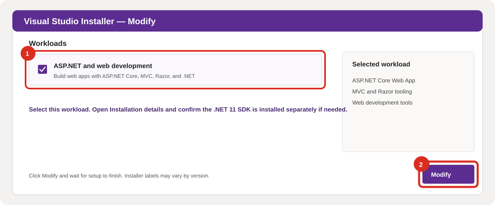

*Setup screen 1 — Select the web workload, then click **Modify**.*

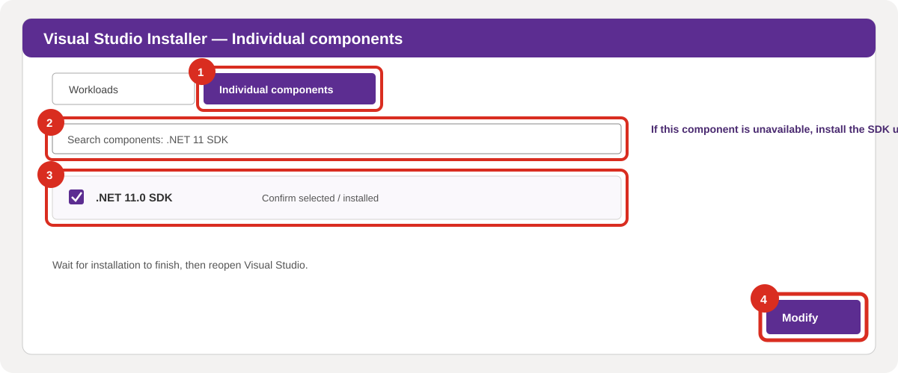

*Setup screen 1a — In **Individual components**, confirm the .NET 11 SDK is selected, then click **Modify** if you changed the selection.*

### 📂 Open this project in Visual Studio

To continue with the project in this folder, **do not create a second project**:

1. Start Visual Studio and click **Open a project or solution**.
2. Browse to this project folder and select `ASP.NET CORE MVC.slnx`.
3. Wait for the solution to load and NuGet packages to restore.
4. In Solution Explorer, right-click `WebApplicationMVCCoreEmsi` and select **Set as Startup Project** if it is not already bold.
5. Select the `https` launch profile and run **Build → Build Solution** once before starting the website.

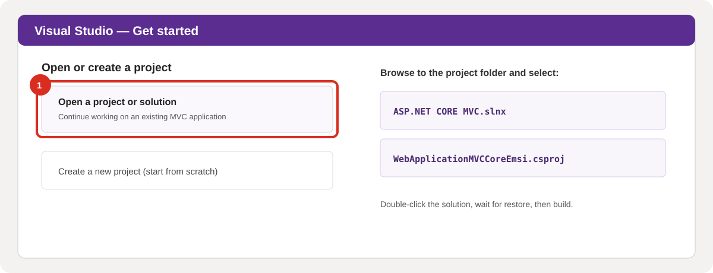

*Setup screen 2 — Open the supplied solution. The separate “Create a new project” path is for students following the exercise from a blank template.*

> 🗃️ The supplied project already targets .NET 11 and references EF Core 11. Its connection string uses the default SQL Server instance and database `MVCCore`. A newly created project should use the database name you enter in its own `appsettings.json`.

---

## 🏗️ How MVC works

| Component | Responsibility in this workshop |
|---|---|
| **Model** | `Employee` describes employee data and validation rules. |
| **View** | Razor `.cshtml` files render the employee list and forms. |
| **Controller** | `EmployeesController` receives requests, uses the context, and returns views. |
| **Database context** | `EmployeeContext` connects EF Core to the `Employees` table. |

A browser request reaches a controller action. The action reads or updates data through the context, then returns a view. Keeping these responsibilities separate makes the application easier to understand, test, and maintain.

---

## 🚀 Part 1 — Create the project

> 🧭 **Choose your path first:** To run the project supplied with this README, use **Open this project in Visual Studio** above; it already contains the model, context, controller, views, and migrations. To learn the construction process from a blank application, continue with the steps below and create a new project. Do not scaffold a second `EmployeesController` into the already completed project.

1. Open **Visual Studio** and select **Create a new project**.
2. Search for **ASP.NET Core Web App (Model-View-Controller)**. Select that template—not Razor Pages—and click **Next**. Use the red frames in the screen below to identify both clicks.

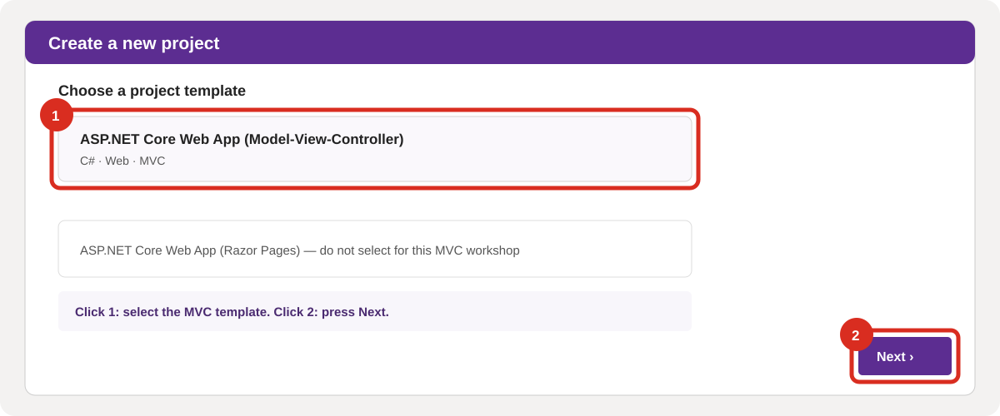

*Figure 1 — Select the MVC template, then click **Next**.*

3. Set the project name to `EmployeeManagement` (or choose your own name) and select a convenient location.
4. In **Additional information**, choose an installed .NET framework, select **No Authentication**, leave **Configure for HTTPS** enabled, and click **Create**.

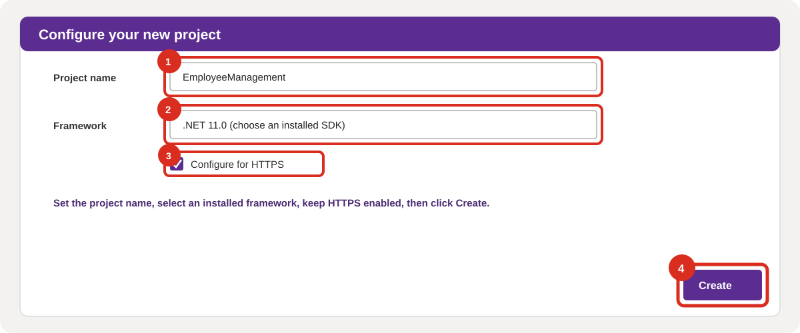

*Figure 2 — Configure the project settings, then click **Create**.*

5. Wait for NuGet restore to finish, then build once with **Build → Build Solution**.

> ✅ The generated project should contain `Controllers`, `Models`, and `Views` folders, along with `Program.cs` and a `.csproj` file.

---

## 📦 Part 2 — Install Entity Framework Core

Entity Framework Core (EF Core) maps C# objects to database tables and translates LINQ queries into SQL.

### Option A — Visual Studio NuGet UI

1. Right-click the project and select **Manage NuGet Packages**.
2. Open **Browse** and install these packages, using the same version for all four:
   - `Microsoft.EntityFrameworkCore`
   - `Microsoft.EntityFrameworkCore.SqlServer`
   - `Microsoft.EntityFrameworkCore.Design`
   - `Microsoft.EntityFrameworkCore.Tools`
3. Accept the license prompts and wait for installation to finish.

### Option B — Package Manager Console

Open **Tools → NuGet Package Manager → Package Manager Console**. In the console toolbar, set **Default project** to your web project. Run each command separately and wait for it to finish:

```powershell
Install-Package Microsoft.EntityFrameworkCore -Version 11.0.0
Install-Package Microsoft.EntityFrameworkCore.SqlServer -Version 11.0.0
Install-Package Microsoft.EntityFrameworkCore.Design -Version 11.0.0
Install-Package Microsoft.EntityFrameworkCore.Tools -Version 11.0.0
```

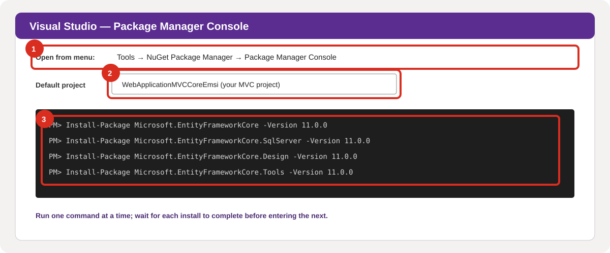

*Setup screen 3 — Select the MVC project in **Default project**, then run the four commands one at a time.*

### 🧰 Install the MVC scaffolding package

This package enables Visual Studio to generate the controller and Razor CRUD views. It is not a Visual Studio Marketplace extension.

1. In **Solution Explorer**, right-click the web project and choose **Manage NuGet Packages**.
2. Select **Browse**, search for `Microsoft.VisualStudio.Web.CodeGeneration.Design`, and select the package published by Microsoft.
3. Select version `11.0.0` for this .NET 11 / EF Core 11 workshop, click **Install**, and accept the prompts.
4. If Visual Studio asks to reload the project, accept the reload before continuing.

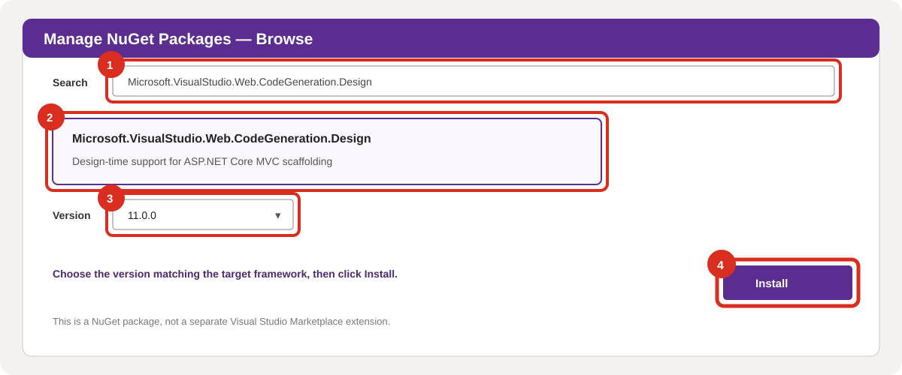

*Setup screen 4 — Install `Microsoft.VisualStudio.Web.CodeGeneration.Design` through NuGet.*

> ✅ The existing project already has the four EF Core packages. Add the scaffolding package only if you are following the guide from scratch or Visual Studio reports that the scaffolding template is unavailable.

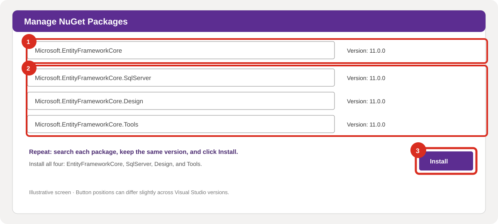

*Setup screen 5 — In a new project, search for each EF Core package, select the matching version, and click **Install**. Repeat for all four.*

> 🔎 If you select another target framework, replace `11.0.0` with compatible package versions. The project in this repository uses EF Core `11.0.0`.

---

## 🧱 Part 3 — Create the Employee model

1. In **Solution Explorer**, right-click **Models** → **Add → Class**.
2. Name the file `Employee.cs` and click **Add** in the class dialog.
3. Add the following model. If your project uses a different namespace, replace `EmployeeManagement.Models` with the namespace shown in your project.

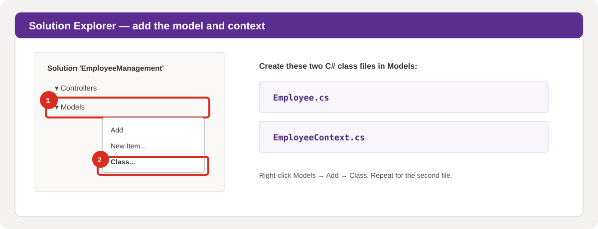

*Figure 4 — Right-click **Models**, choose **Add → Class**, and create `Employee.cs` and `EmployeeContext.cs` using the same steps.*

```csharp
using System.ComponentModel.DataAnnotations;

namespace EmployeeManagement.Models;

public class Employee
{
	public int EmployeeId { get; set; }

	[Required]
	[Display(Name = "Last Name")]
	public string LastName { get; set; } = string.Empty;

	[Required]
	[Display(Name = "First Name")]
	public string FirstName { get; set; } = string.Empty;

	[MaxLength(255)]
	[Display(Name = "Position")]
	public string? Position { get; set; }
}
```

### What the annotations mean

- `EmployeeId` is the primary key by EF Core convention. It is generated automatically when a row is inserted.
- `[Required]` prevents an empty last or first name.
- `[Display(Name = ...)]` gives the form a readable English label.
- `[MaxLength(255)]` limits the position field to 255 characters.
- `string?` makes `Position` optional. Remove `?` and add `[Required]` if every employee must have a position.

---

## 🗄️ Part 4 — Create the database context

1. Right-click **Models** → **Add → Class**.
2. Name the file `EmployeeContext.cs`.
3. Add this code:

```csharp
using Microsoft.EntityFrameworkCore;

namespace EmployeeManagement.Models;

public class EmployeeContext : DbContext
{
	public EmployeeContext(DbContextOptions<EmployeeContext> options)
		: base(options)
	{
	}

	public DbSet<Employee> Employees => Set<Employee>();
}
```

`DbSet<Employee>` represents the collection of employee records that EF Core can query and save.

---

## 🔌 Part 5 — Configure SQL Server

### 5.1 Check that SQL Server is running

Open **SQL Server Configuration Manager** or the Windows **Services** app and confirm that your SQL Server service is running.

Common local connection strings:

**Default SQL Server instance:**

```text
Server=.;Initial Catalog=EmployeeManagementDb;Integrated Security=True;Encrypt=False;TrustServerCertificate=True
```

**SQL Server Express named instance:**

```text
Server=.\SQLEXPRESS;Initial Catalog=EmployeeManagementDb;Integrated Security=True;Encrypt=False;TrustServerCertificate=True
```

Use the instance name installed on your computer. In SSMS, the server name shown on the connection screen identifies the instance to use.

### 5.2 Add the connection string

In **Solution Explorer**, double-click `appsettings.json` to open it in the Visual Studio editor. For a new walkthrough project, add `ConnectionStrings` at the root of the JSON object (commas matter):

```json
{
  "Logging": {
	"LogLevel": {
	  "Default": "Information",
	  "Microsoft.AspNetCore": "Warning"
	}
  },
  "AllowedHosts": "*",
  "ConnectionStrings": {
	"DefaultConnection": "Server=.;Initial Catalog=EmployeeManagementDb;Integrated Security=True;Encrypt=False;TrustServerCertificate=True"
  }
}
```

The connection above is appropriate for local development with Windows Authentication. For a different instance, change only the `Server` value. Never commit production passwords or other secrets to source control.

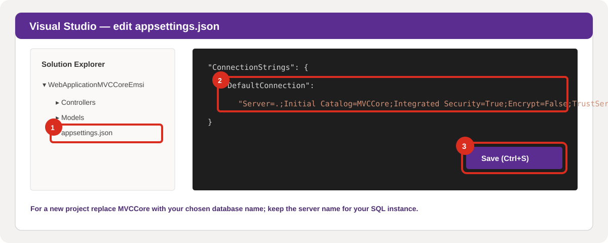

*Setup screen 6 — In Solution Explorer open `appsettings.json`, update the connection string for your SQL Server instance, and save with **Ctrl+S**.*

> 🗃️ **Supplied project:** its existing connection string uses `Initial Catalog=MVCCore`. Keep that database name when running the supplied solution. The `EmployeeManagementDb` value above is for a new project; changing a database name creates or targets a different database.

---

## 🧭 Part 6 — Register MVC and Entity Framework

Open `Program.cs` and register the context before `builder.Build()`. The culture configuration also keeps validation messages in English:

```csharp
using System.Globalization;
using EmployeeManagement.Models;
using Microsoft.AspNetCore.Localization;
using Microsoft.EntityFrameworkCore;

var builder = WebApplication.CreateBuilder(args);

builder.Services.Configure<RequestLocalizationOptions>(options =>
{
	var englishCulture = new CultureInfo("en-US");
	options.DefaultRequestCulture = new RequestCulture(englishCulture);
	options.SupportedCultures = new[] { englishCulture };
	options.SupportedUICultures = new[] { englishCulture };
});

var connectionString = builder.Configuration.GetConnectionString("DefaultConnection")
	?? throw new InvalidOperationException("Connection string 'DefaultConnection' was not found.");

builder.Services.AddDbContext<EmployeeContext>(options =>
	options.UseSqlServer(connectionString));

builder.Services.AddControllersWithViews();

var app = builder.Build();

if (!app.Environment.IsDevelopment())
{
	app.UseExceptionHandler("/Home/Error");
	app.UseHsts();
}

app.UseRequestLocalization();
app.UseHttpsRedirection();
app.UseRouting();
app.UseAuthorization();

app.MapStaticAssets();
app.MapControllerRoute(
	name: "default",
	pattern: "{controller=Home}/{action=Index}/{id?}")
	.WithStaticAssets();

app.Run();
```

> 🧩 `MapStaticAssets()` is used by the current .NET 11 template. If you target an older ASP.NET Core version, keep the static-file middleware generated by that version's template instead of copying this line blindly.

Build the project now. Fix any errors before continuing: **Build → Build Solution** or run `dotnet build` in the project folder.

---

## ⚙️ Part 7 — Generate the CRUD controller and views

Scaffolding creates the standard MVC actions and Razor pages from the model and context. This step is for a **new project being built from scratch**; the supplied project already contains these files.

1. Confirm that `Microsoft.VisualStudio.Web.CodeGeneration.Design` is installed in the web project (see Part 2). If you installed it while Visual Studio was open, wait for the package restore/reload to finish.
2. In **Solution Explorer**, right-click the **Controllers** folder → **Add → New Scaffolded Item...**.
3. Select **MVC Controller with views, using Entity Framework** in the left-hand list, then click **Add**.
4. Set:
   - **Model class:** `Employee`
   - **Data context class:** `EmployeeContext`
   - **Controller name:** `EmployeesController`
   - **Generate views:** checked
   - **Use a layout page:** checked (leave the default layout path)
5. Click **Add** and wait for code generation to finish.

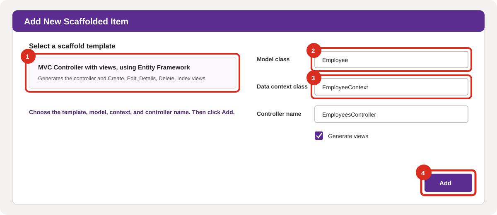

*Figure 7 — Select the highlighted template, set the model, context, and controller name, keep **Generate views** checked, then click **Add**.*

Visual Studio should create `EmployeesController.cs` and the `Views/Employees` folder containing `Create.cshtml`, `Delete.cshtml`, `Details.cshtml`, `Edit.cshtml`, and `Index.cshtml`.

> 💡 The controller in this repository demonstrates the same CRUD flow. You can compare it with the scaffolded controller after generation: [EmployeesController.cs](Controllers/EmployeesController.cs).

---

## 🧬 Part 8 — Create the database with migrations

A migration is a versioned description of a database schema change. EF Core uses it to create or update the database.

> ⚠️ **For a new project only:** run `Add-Migration InitialCreate` once to create its first migration. The supplied project already has migrations and targets the existing `MVCCore` database; do not create another `InitialCreate` migration in it. For the supplied project, use `Update-Database` only if you need to bring that database up to the migrations already in the project.

### Visual Studio Package Manager Console

Open **Tools → NuGet Package Manager → Package Manager Console**. Set **Default project** to your web project, then run:

```powershell
Add-Migration InitialCreate
Update-Database
```

### .NET CLI alternative

From the folder containing the `.csproj` file, run:

```powershell
dotnet tool install --global dotnet-ef --version 11.0.0
dotnet ef migrations add InitialCreate
dotnet ef database update
```

If `dotnet-ef` is already installed, skip the first command. Keep the tool's major version aligned with the EF Core packages.

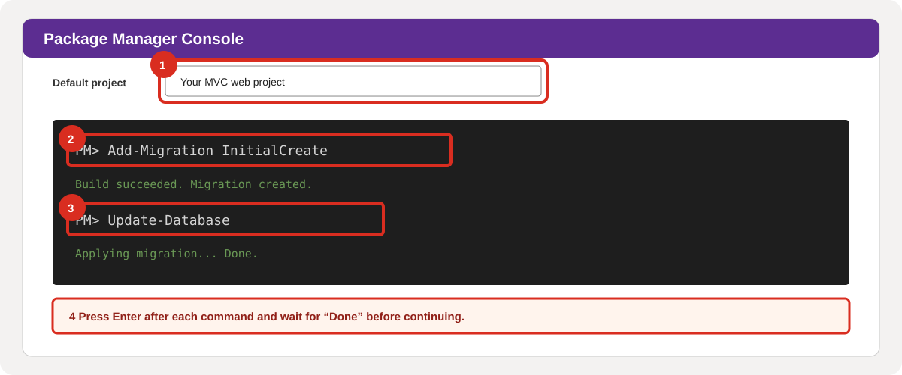

*Figure 8 — For a new project only, select the web project, run both commands one at a time, press **Enter**, and wait for `Done`. For the supplied project, run only `Update-Database` if required; do not repeat `Add-Migration InitialCreate`.*

### Verify the database

In SSMS, connect to the same SQL Server instance and refresh **Databases**. For a new walkthrough project, you should see `EmployeeManagementDb`; for the supplied project, check `MVCCore`. Both should have an `Employees` table containing:

| Column | Type | Nullable | Purpose |
|---|---|---:|---|
| `EmployeeId` | `int` (identity) | No | Primary key |
| `LastName` | `nvarchar(max)` | No | Employee last name |
| `FirstName` | `nvarchar(max)` | No | Employee first name |
| `Position` | `nvarchar(255)` | Yes | Optional job position |

> ⚠️ If migrations fail, fix the connection or package-version issue first. Do not delete your database as a troubleshooting shortcut if it contains data you need.

---

## 🎨 Part 9 — Add Employees to the navigation bar

Open `Views/Shared/_Layout.cshtml`. Inside the existing `<ul class="navbar-nav flex-grow-1">`, add:

```razor
<li class="nav-item">
	<a class="nav-link text-dark"
	   asp-area=""
	   asp-controller="Employees"
	   asp-action="Index">Employees</a>
</li>
```

Ensure the view imports include the model namespace. Open `Views/_ViewImports.cshtml` and add the appropriate `@using` directive:

```razor
@using EmployeeManagement.Models
```

The MVC template already includes the tag helpers required by `asp-controller`, `asp-action`, and `asp-for`:

```razor
@addTagHelper *, Microsoft.AspNetCore.Mvc.TagHelpers
```

---

## ▶️ Part 10 — Run and test the application

1. Build the project and resolve any errors.
2. In Visual Studio, select the **https** launch profile and press **Ctrl+F5** (or click **Start Without Debugging**).
3. Select **Employees** in the navigation bar. The page should open at `/Employees`.
4. Test each operation:
   - **Create:** add an employee and confirm it appears in the list.
   - **Details:** open the employee's details page.
   - **Edit:** change a field and confirm the update is saved.
   - **Delete:** delete the test record and confirm it disappears.
5. Try submitting a blank last name or first name; the required-field validation should prevent saving.

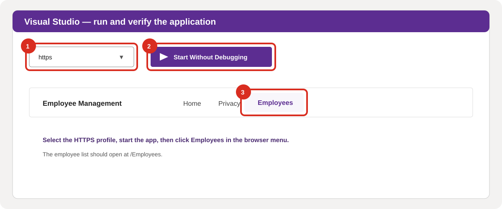

*Figure 9 — Select **https**, click **Start Without Debugging** (or press **Ctrl+F5**), then click **Employees** in the browser.*

The finished employee-list preview and example output are shown in [Final Result Preview](#final-result-preview). Use your own test records to verify each CRUD operation.

You can also run the project from a terminal:

```powershell
dotnet run
```

Use the local URL printed by the application. Stop the application with **Ctrl+C** in the terminal.

---

## 🗂️ Expected project structure

```text
EmployeeManagement/
├── Controllers/
│   ├── EmployeesController.cs
│   └── HomeController.cs
├── Models/
│   ├── Employee.cs
│   ├── EmployeeContext.cs
│   └── ErrorViewModel.cs
├── Migrations/
│   ├── <timestamp>_InitialCreate.cs
│   └── EmployeeContextModelSnapshot.cs
├── Views/
│   ├── Employees/
│   │   ├── Create.cshtml
│   │   ├── Delete.cshtml
│   │   ├── Details.cshtml
│   │   ├── Edit.cshtml
│   │   └── Index.cshtml
│   ├── Home/
│   └── Shared/
│       └── _Layout.cshtml
├── appsettings.json
├── Program.cs
└── EmployeeManagement.csproj
```

The names in the tree are the recommended names for a fresh walkthrough project. This repository's project and namespace names may differ; its working employee implementation is under `Controllers/EmployeesController.cs`, `Models/Employee.cs`, `Models/EmployeeContext.cs`, and `Views/Employees/`.

---

## 🧯 Troubleshooting

| Symptom | Likely cause | What to check |
|---|---|---|
| `No connection string named 'DefaultConnection' was found` | The JSON key is missing or misspelled. | Confirm `ConnectionStrings:DefaultConnection` exists in `appsettings.json`. |
| `A network-related or instance-specific error` | SQL Server is stopped, or the instance name is wrong. | Start SQL Server and use the exact default or Express instance name from SSMS. |
| `Login failed` or Windows Authentication is rejected | The current Windows account cannot connect to the instance. | Connect in SSMS with Windows Authentication and grant the account access if needed. |
| `Add-Migration` is not recognized | EF Core Tools is not installed or the wrong console is open. | Use Visual Studio's **Package Manager Console** and install `Microsoft.EntityFrameworkCore.Tools`. |
| EF reports package or tool version conflicts | EF Core package and tool versions do not match. | Align their major versions; restore NuGet packages and rebuild. |
| The scaffold option is missing | MVC code-generation tooling is unavailable. | Install the compatible `Microsoft.VisualStudio.Web.CodeGeneration.Design` package and reopen the scaffolding dialog. |
| `/Employees` returns 404 | Controller, route, or view folder name does not match. | Confirm the controller is `EmployeesController` and views are in `Views/Employees`. |
| Razor cannot find `Employee` | The model namespace is not imported. | Add the model namespace to `Views/_ViewImports.cshtml`. |
| A view says that a table or column does not exist | The database schema is behind the model. | Check the active connection string, then run `Update-Database` against the intended database. |
| The port is already in use | Another app is using the configured port. | Stop the other process or change `applicationUrl` in `Properties/launchSettings.json`. |

---

## ✅ Final checklist

- [ ] The web project builds without errors.
- [ ] EF Core packages match the target framework and each other.
- [ ] The SQL Server instance is running and the connection string targets it.
- [ ] `Employee` and `EmployeeContext` are in the Models folder.
- [ ] `EmployeesController` and all five employee views exist.
- [ ] The new project's initial migration is applied, or the supplied project's existing migrations are applied, and the `Employees` table exists.
- [ ] The **Employees** navigation link opens `/Employees`.
- [ ] Create, list, details, edit, delete, and required-field validation work.
- [ ] No database credentials or production secrets are committed.

---

## 🔗 References

- [ASP.NET Core MVC overview](https://learn.microsoft.com/aspnet/core/mvc/overview)
- [Entity Framework Core documentation](https://learn.microsoft.com/ef/core/)
- [EF Core migrations](https://learn.microsoft.com/ef/core/managing-schemas/migrations/)
- [Scaffold an ASP.NET Core MVC controller](https://learn.microsoft.com/aspnet/core/tutorials/first-mvc-app/controller-methods-views)
- [SQL Server connection strings](https://learn.microsoft.com/sql/connect/ado-net/connection-strings)

---

<div align="center">

### Workshop complete

**Model** → **Controller** → **View** → **Entity Framework Core** → **SQL Server**

Built with care by [Youssef Lagmouch](https://github.com/Lagmouchyoussef).

</div>
